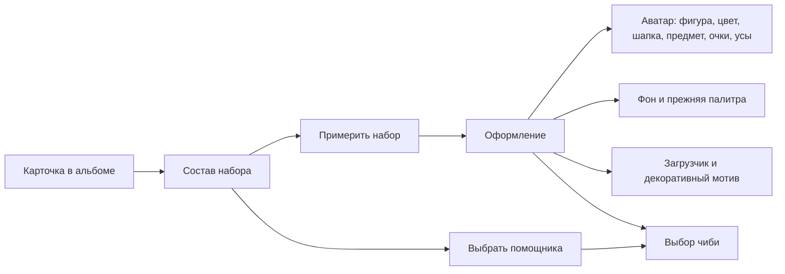

# Контракт наборов персонажей, версия 1

Дата: 26 октября 2026 года. Этап 1 выполнен: форматы, геометрия, правила и схема дальнейшего хранения определены и проверяются кодом. Публикация графики, выдача наборов, интерфейс примерочной, чтение учебных данных и обращения к OpenAI относятся к этапам 2–6.

## Реализованные источники истины

| Файл | Назначение |
| --- | --- |
| `tower/content/character_sets.json` | 12 черновиков наборов, 72 компонента, стабильные идентификаторы и планируемые пути графики |
| `tower/content/avatar_geometry.json` | Нормализованные крепления пяти существующих фигур |
| `tower/character_contracts.py` | Проверяемые модели каталога, предметов, выбранного оформления и поведенческого профиля; экспорт JSON Schema |
| `tower/avatar_geometry.py` | Единый расчёт совмещения изображения и фигуры |
| `tower/companion_contracts.py` | Приоритет источников, общий интервал аккаунта, состояния доступности и версия комментария |
| `tower/management/commands/check_character_sets.py` | Проверка без публикации, выдачи предметов, чтения БД и вызова ИИ; экспорт схем и геометрического предпросмотра |

Новые контракты не подключены к ученическим страницам. БД, баланс, результаты открытых паков и текущий вид аватарок на этом этапе не меняются. Добавлять миграции для ещё не используемых таблиц на этапе проектирования не требуется; будущие изменения хранения перечислены ниже и входят в этапы их внедрения.

## Каталог и состав набора

`schema_version` описывает формат документа, `revision` — версию набора отдельного персонажа. Идентификатор версии: `<hero_id>-v<revision>`. Идентификаторы компонентов сохраняются между ревизиями; изображения имеют версии в пути. Опубликованный снимок набора неизменяем: изменение требует новой ревизии.

| Слот | Содержимое | Крепление | Выбор |
| --- | --- | --- | --- |
| `head` | Шапка | `head` | Одна шапка |
| `prop` | Книга, приставка, игрушка и т. п. | `hand`, `side` или `ground` | Один предмет |
| `background` | Фоновое изображение | Подложка страницы | Один фон |
| `ui_loader` | Графика загрузчика | Зарезервированная область индикатора | Один загрузчик |
| `ui_decoration` | Небольшой мотив возле кнопок и блоков | Именованные места в шаблонах | Один мотив |
| `companion` | Чиби и ссылка на его характер | Виджет помощника | Один помощник |

Один декоративный мотив может использоваться в нескольких разрешённых местах интерфейса. Позиционирование возле кнопок задаётся шаблоном; пользовательский контент или координаты предмета аватарки на это не влияют. Вращение предусмотрено только для загрузчика, с учётом отключения анимаций. Три точки во время подготовки реплики — отдельное состояние облачка, а не заменяющий его загрузчик платформы.

Все шесть компонентов получаются вместе при первой полной сборке персонажа. Выбор любого компонента независим от остальных. Удаление компонента из выбранного оформления не удаляет владение им. Получение нового набора не меняет выбранные настройки.

Каждый компонент содержит `id`, `slot`, названия на `ru/kk/en`, размер изображения и относительный путь. Шапка и предмет дополнительно содержат `attachment`; чиби — `behavior_profile`. Посторонние поля, несовпадение ключа и слота, чужой персонаж/ревизия в пути и неполный набор отклоняются валидатором.

Пример идентификаторов: `nis-coder-head`, `nis-coder-prop`, `nis-coder-ui-loader`, `nis-coder-companion`. Путь: `sets/nis-coder/v1/head.webp`. Это планируемые ключи объектов, а не утверждение, что файлы уже загружены в Cloudflare. До завершения графики и профилей все наборы имеют `status=draft`; публичная выборка их исключает. Перевод в `published` на этапе публикации требует проверки существования и размеров ассетов, наличия профиля характера и доступности всех компонентов. Проверка схемы сама по себе этого не подтверждает.

Предложенные предметы и размеры сейчас служат техническим черновиком для художника. Их можно менять до публикации версии. Идентификаторы существующих покупок не переиспользуются.

## Система координат и совмещение

Начало координат — левый верхний угол квадратного контейнера аватарки. X направлен вправо, Y вниз. Точки фигуры и точки изображения задаются в диапазоне 0–1. Размер и поворот нормализуются отдельно. Важна точка предмета внутри полного изображения, включая прозрачные поля: обрезка прозрачных краёв требует обновления этой точки и размеров.

Фигура хранит четыре крепления, каждое из которых содержит:

- `point`: XY точки совмещения относительно всего контейнера;
- `span`: опорную ширину крепления относительно стороны контейнера;
- `rotation`: базовый поворот в градусах по часовой стрелке.

Изображение предмета хранит исходные `width/height`. Его `attachment` содержит имя крепления, `pivot` внутри картинки, `width_ratio` относительно опорной ширины, дополнительный `rotation` и `layer=behind|front`.

Для контейнера со стороной S, опорной ширины A, отношения R и исходной ширины картинки W масштаб k = S × A × R / W. Общий угол — сумма поворотов крепления и предмета. Любая точка картинки P переводится в координаты контейнера так:

`P_view = S × anchor.point + Rotate(angle) × k × (P - pivot_in_image_pixels)`

Поэтому опора предмета всегда попадает точно в крепление фигуры при любом размере, соотношении сторон и повороте. Изображение масштабируется равномерно, без растяжения. Рассчитанная матрица одинаково применима в SVG и CSS с `transform-origin: 0 0`; CSS-элемент должен иметь исходные размеры изображения и находиться в начале контейнера. Фоновое изображение страницы к этой формуле не относится.

Порядок слоёв для будущего общего рендера: предметы `behind`, тело фигуры, глаза, предметы `front`. Существующие очки и усы сохраняют свои позиции поверх лица. При внедрении нового рендера их следует перевести на отдельные крепления лица либо сохранить совместимый слой; смещать их вслед за шапкой нельзя.

Начальные крепления рассчитаны для существующих силуэтов. Проверка визуальной посадки на окончательных изображениях и калибровка выполняются на этапе 2. Доказана геометрическая инвариантность, а не художественная точность ещё не созданных изображений.

## Владение, выбор и последующая схема БД

`AppearanceSelection` — переносимый контракт выбранного оформления. Он содержит фигуру, цвет, `legacy_theme` и ссылки на предметы по слотам. Выбор не даёт владение. Перед сохранением сервер сопоставляет каждый ID с инвентарём ученика и проверяет совпадение слота. Проверка владения в контракте получает уже проверенный сервером словарь `component_id → slot`; запрос к БД и проверка действующего доступа будут в сервисе сохранения на этапе 4.

Совместимость: прежние `head`, `glasses`, `mustache` сохраняют идентификаторы. `forest` и `parchment` остаются темами палитры, а новая фоновая картинка — независимым слотом `background`. Адаптер `AppearanceSelection.from_legacy` переносит эти значения без перезаписи аккаунта и отбрасывает только пустые значения.

Схема внедрения хранения:

| Сущность | Поля и ограничения | Этап |
| --- | --- | --- |
| `CharacterSetVersion` | Персонаж, ревизия, неизменяемый JSON-снимок набора и ссылка на версию характера; уникальность персонаж + ревизия | 3 |
| Текущая публикация набора | Ссылка персонажа на опубликованную версию; проверка, что версия относится к тому же персонажу; черновик не активируется | 3 |
| `PlayerCharacterSet` | Игрок, персонаж, версия выдачи, время и исходная операция при наличии; уникальность игрок + персонаж | 3 |
| `CosmeticDefinition` | Расширение существующего каталога шестью типами компонентов; данные отображения из опубликованной версии, способ получения `purchase` либо `character_set` | 3 |
| `PlayerCosmetic` | Сохранение всех прежних покупок; ссылка на набор-источник для новых компонентов; одна запись владения на игрока и предмет | 3 |
| `TowerPlayer` | Существующие фигура/цвет/аксессуары/тема плюс независимые ссылки на фон, загрузчик, мотив и чиби; `prop` добавляется к аксессуарам | 4 |
| `CompanionState` | OneToOne с игроком: последний успешный ответ, активная резервация и срок, задержка повторов; выбранный чиби читается из оформления | 6 |
| `CompanionMessage` | Игрок, UUID запроса, чиби и версия характера, источник и его версия, состояние операции, текст, серверная цель перехода, время сохранения/доставки, расход токенов; уникальность игрок + UUID | 6 |
| `FeedbackConsideration` | Игрок, ответ экзамена, отпечаток текста комментария, доставленное сообщение и время показа; уникальность игрок + ответ + отпечаток | 5–6 |

Существующая `PlayerCosmetic.operation` — OneToOne, что допускает только один предмет на операцию. На этапе 3 она станет nullable ForeignKey: прежние покупки сохранят свои операции; компоненты набора получат общий источник выдачи без фиктивных денежных проводок. Ограничение источника потребует для покупки реальную операцию, для выдачи — `PlayerCharacterSet`. Изменение вводится отдельной миграцией вместе с сервисом выдачи и проверкой восстановления прежних сборок, а не заранее.

## Учебные источники и характер

OpenAI формулирует текст выбранной ситуации. Приоритет и проверка данных остаются на сервере. Контракт `SourceCandidate` принимает только уже отобранные доступные ресурсы: `kind`, положительный ID, версию и время предыдущего показа. В нём нет модели персонажа, поэтому смена чиби не меняет историю.

1. `unfinished`: незавершённая работа. Код — нет успешного решения; квиз — нет отправленной попытки; экзамен — назначен и доступен, но не отправлен. Ошибочный отправленный квиз не называется пропущенным, работа в ожидании оценки — выполнена. Посещённый урок считается оставленным после завершения работы в нём или перехода к другому уроку. Недоступные ресурсы исключаются. Экзамены проверяются отдельно по назначениям классу: связи с уроком в текущей модели нет.
2. `teacher_feedback`: непустой доступный ученику комментарий к оценённому ответу с баллом ниже максимального. Идентичность — тип + ID ответа + SHA-256 нормализованного текста. Изменение только пробелов не возобновляет разбор; содержательное изменение возобновляет. Один текст в разных ответах — разные источники.
3. `lesson_fact`: последний посещённый урок по `StudentSession.last_seen_at`; случайный доступный активный модуль с текстом, затем случайный непустой текстовый блок. При возможности не повторять прежний блок подряд. При отсутствии текста возвращается пустое состояние.

Сервис этапа 5 отбирает ресурсы и предоставляет один случайно выбранный факт-кандидат. Чистая функция `choose_source` закрепляет порядок приоритетов, исключает рассмотренные версии комментариев и выбирает ещё не показанный либо давно показанный ресурс внутри приоритета. Наличие актуальной незавершённой работы сохраняет её первый приоритет даже после предыдущего напоминания.

`BehaviorProfile` задаёт персонажа и ревизию, темперамент, тон, словарь, юмор, способ поддержки и 2–4 примера на каждом языке. Содержательные портреты создаются на этапе 2. Общие требования промпта: 2–4 коротких предложения, максимум 600 символов; доброжелательность; естественное описание сути задания; сохранение смысла учительского комментария; факты только из переданного материала; отсутствие готовых решений для незавершённой работы. Эти правила обязательны для любого характера и редкости.

Контекст для OpenAI на этапе 6: выбранный источник и минимум содержимого для его интерпретации, язык интерфейса, опубликованный характер. ФИО, PIN, данные других учеников, приватные заметки и скрытые ответы не входят в контракт. Тексты материала и комментариев передаются как данные, отдельно от инструкций. Ссылки строит сервер; модель возвращает текст.

## Интервал, получение ответа и состояния виджета

Интервал — ровно 1800 секунд после фиксации валидного ответа в БД. Область — игрок целиком, независимо от персонажа, вкладки и устройства. Входы `account_availability` относятся к аккаунту и принимают только даты с часовым поясом. Проверка доступности не обращается к OpenAI.

| Состояние | Условие | Отображение и действие |
| --- | --- | --- |
| `inactive` | Функция выключена или чиби не выбран | Компактный/скрытый виджет; генерации нет |
| `generating` | Есть действующая резервация | Облачко с тремя точками; повтор использует ту же операцию |
| `cooldown` | После успешного ответа прошло меньше 30 минут | Сохранённая реплика доступна; новый запрос после серверного времени |
| `retry_wait` | Короткая задержка после технической ошибки | Нейтральная ошибка интерфейса и возможность повтора после задержки |
| `empty` | Подходящих источников нет | Спокойный чиби без красного значка; обращения к ИИ нет |
| `ready` | Есть источник и ограничения истекли | Красный «!»; нажатие запускает генерацию |

По достижении точного времени `last_success_at + 30 минут` запрос становится доступен. Технические сообщения интерфейса не выдаются за реплики персонажа. Содержательные реплики всегда создаются через API; повторное чтение сохранённого результата не является новой генерацией.

Сохранённое, но ещё не доставленное сообщение имеет приоритет перед новой генерацией: следующий запрос возвращает его, даже если с сохранения прошло 30 минут. При необходимости виджет показывает доступность этой реплики отдельно от доступности генерации. Это правило относится к доставке сообщений, тогда как `account_availability` вычисляет только состояние новой генерации.

Для сервиса этапа 6: короткая транзакция резервирования → API вне блокировки БД → короткая транзакция сохранения с проверкой действующего токена резервации. Начальные параметры: резервация 90 секунд, задержка после ошибки 30 секунд. Сетевой таймаут должен быть короче резервации. Повтор того же UUID читает ту же операцию. Поздний ответ от утратившей силу резервации не перезаписывает новый результат. При неопределённом исходе сетевого запроса немедленный параллельный повтор запрещён.

Комментарий резервируется для операции; считается рассмотренным после доставки сохранённой реплики клиенту и подтверждения показа. При потере ответа клиент получает тот же текст после перезагрузки. Ошибка API не создаёт пометку разбора и не запускает получасовой интервал. Существующий ответ всегда можно перечитать, не расходуя новый запрос.

## Карта интерфейса для этапа 4



Общее правило: примерка меняет только предпросмотр, «Сохранить» фиксирует выбор после серверной проверки владения. Для полного набора доступна одна примерка всех компонентов; каждый слот затем изменяется отдельно. Есть возврат к стандартному виду и сворачивание помощника. В экзамене и активной игре облачко не перекрывает работу; декоративные элементы не меняют размеры и зоны нажатия кнопок.

## Проверка контракта

```powershell
python manage.py check_character_sets
python manage.py check_character_sets --schema
python manage.py check_character_sets --preview artifacts/tower/character-sets/attachment-geometry.svg
python manage.py test tower.tests.test_character_contracts --noinput
```

`--require-published` сейчас ожидаемо завершится ошибкой: все 12 наборов черновые. Эта проверка ловит неполный статус каталога; фактическую доступность графики и профилей дополнительно проверит будущая публикация.

Проверяются геометрическое совпадение опоры при разных размерах/поворотах/пропорциях, отсутствие искажений изображения, недопустимые пути и слоты, смешанное оформление, сохранность реальных прежних покупок/настроек, отсутствие выдачи и вызовов ИИ, точная граница 30 минут, история комментариев и приоритеты источников.

Проверено 26 октября 2026 года: 24 новых теста прошли в общем прогоне `core tower`. Всего 265 тестов: 256 успешных, 9 конкурентных проверок требуют PostgreSQL и пропущены на SQLite. Django check и проверка отсутствия незапланированных миграций прошли. Изменений моделей/миграций БД на этапе 1 нет.
